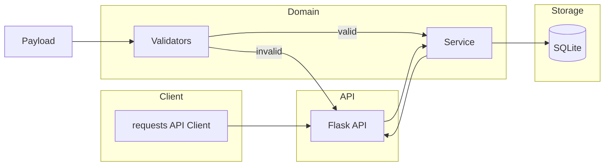

# LoanFlow

**LoanFlow** is a fictional digital-loan practice project that demonstrates a complete
software testing automation framework: business validation, REST API testing, SQL database
testing and end-to-end integration testing, all built with Python and pytest.

> **Disclaimer:** LoanFlow is a portfolio and interview-preparation project. It does not
> represent a real lending platform, real financial API, real bank, or real applicant data.
> All rules, identifiers, amounts and emails are synthetic.

---

## Project purpose

Building a loan application feature is easy. Building one that is **safe, correct and
maintainable** under constant change is hard. This project shows how a QA automation
engineer structures a Python test suite for a (fictional) loan workflow.

1. submit a synthetic application,
2. validate every field,
3. reject invalid requests with field-level errors,
4. persist accepted applications into a relational store,
5. retrieve and verify stored state,
6. report via pytest with HTML and JUnit output.

## Problem statement

Manual API and database testing of a lending workflow is slow, error prone and hard to
re-run. A reusable validation layer, a small REST contract, a repository and an automated
suite are needed so that regressions in validation boundaries, status transitions or
persistence are caught immediately.

## Key features

- Reusable, typed loan validation engine with business rules and error codes.
- Pytest suite with unit, API, database, integration and legacy test groups.
- Parameterized tests for boundary values and equivalence classes.
- Local Flask mock API driven by the real service layer (no third-party API needed).
- requests-based API client with timeout, connection-error and response-shape handling.
- SQLite database layer with transactions, rollback, constraints and parameterized queries.
- Integration tests proving response and database values agree.
- Mutation checks that verify the suite catches weakened business rules.
- HTML + JUnit test reports.
- GitHub Actions workflow that runs the suite.

## Architecture overview



## Folder structure

```
LoanFlow/
├── clients/            # requests based API client + exceptions
├── database/           # SQLite connection + repository
├── loanflow/           # validators, models, services, config, exceptions, logging
├── api/                # Flask app factory + local server runner
├── tests/
│   ├── unit/           # validators, services
│   ├── api/            # mock server + client tests
│   ├── database/       # SQLite repository tests
│   ├── integration/   # cross layer workflow tests
│   └── test_loan_validation.py
├── test_data/          # synthetic JSON fixtures
├── scripts/            # mutation check runner
├── docs/               # business rules and testing strategy
├── reports/            # generated HTML / JUnit reports
├── .github/workflows/ # CI
├── conftest.py         # shared fixtures
├── pytest.ini
├── requirements.txt
└── README.md
```

## Prerequisites

- Python 3.12+ (project verified on Python 3.14).
- Existing virtual environment at `.venv` **or** a new one:
  ```powershell
  python -m venv .venv
  ```

## Windows setup

```powershell
cd C:\Users\gvpra\OneDrive\Desktop\LoanFlow
.\.venv\Scripts\Activate.ps1
python -m pip install -r requirements.txt
```

## Dependency installation

```powershell
python -m pip install -r requirements.txt
```

## Exact test commands

```powershell
# Full suite (with HTML + JUnit reports)
python -m pytest --html=reports/report.html --self-contained-html --junitxml=reports/junit.xml

# Plain run
python -m pytest

# Individual groups
python -m pytest tests/unit -v
python -m pytest tests/api -v
python -m pytest tests/database -v
python -m pytest tests/integration -v

# Mutation checks (expect the suite to fail when rules are weakened)
python scripts/mutation_check.py
```

## Test categories

| Marker | Path | Contents |
|---|---|---|
| `unit` | `tests/unit` | Validation boundaries, equivalence classes, status transitions, service behaviour. |
| `api` | `tests/api` | Local mock server HTTP contract, status codes, error bodies, timeouts, client error handling. |
| `database` | `tests/database` | CRUD, constraints, duplicates, rollback, SQL injection resistance. |
| `integration` | `tests/integration` | Validation -> persistence -> retrieval -> API consistency. |
| `slow` | - | Slow endpoint tests. |
| `mutation` | - | Excluded from default run; used by `scripts/mutation_check.py`. |

## Example output

```
================== 63 passed, 0 failed in 74.51s ==================
```

## Test reports

```powershell
python -m pytest --html=reports/report.html --self-contained-html --junitxml=reports/junit.xml
```

- HTML report: `reports/report.html`
- JUnit report: `reports/junit.xml`

## Design decisions

- Validation lives in `loanflow/validators.py`; no business decision is scattered in tests or API handlers.
- Service layer coordinates validation, duplicate detection and persistence.
- Database layer owns SQL; tests never touch raw SQL except for constraint/injection checks.
- Local server is started per test on an ephemeral port with a temporary database.

## Known limitations

- Fictional rules only; not a real lending product.
- Money values are floats; production would use decimal types.
- No authentication, rate limiting or persistence of real data.

## Future improvements

- PostgreSQL instead of SQLite, JWT auth, async HTTP client.

## AWS preparation

See `INTERVIEW_PREPARATION.md` and `docs/`.

## Fictional disclaimer

All applicants, emails, amounts and statuses are synthetic.
